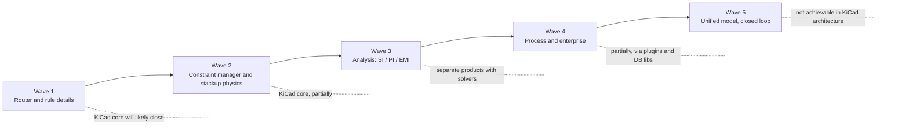
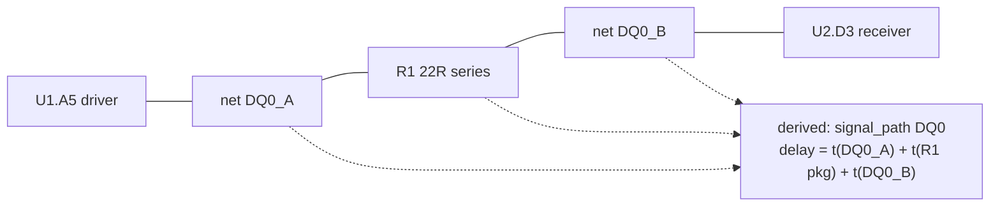
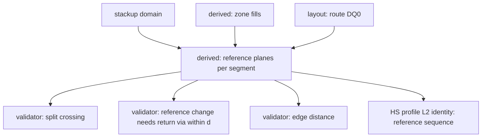
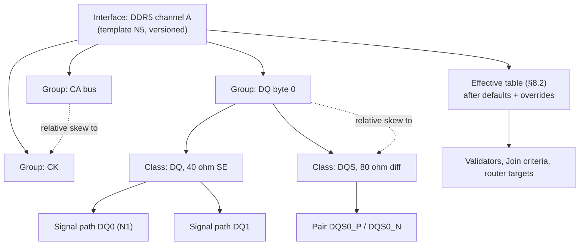
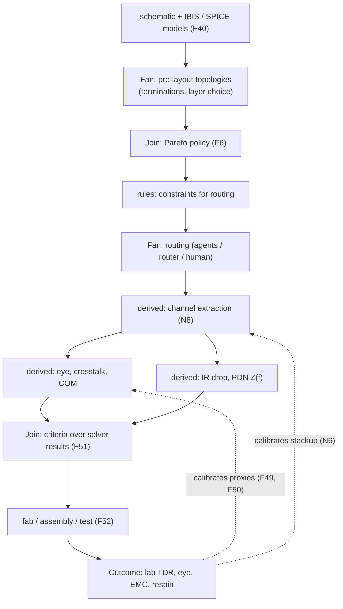
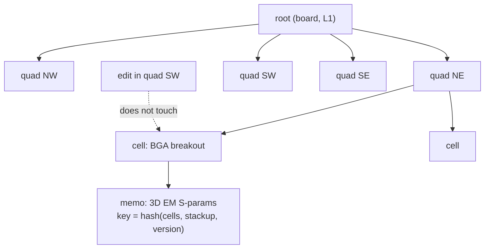
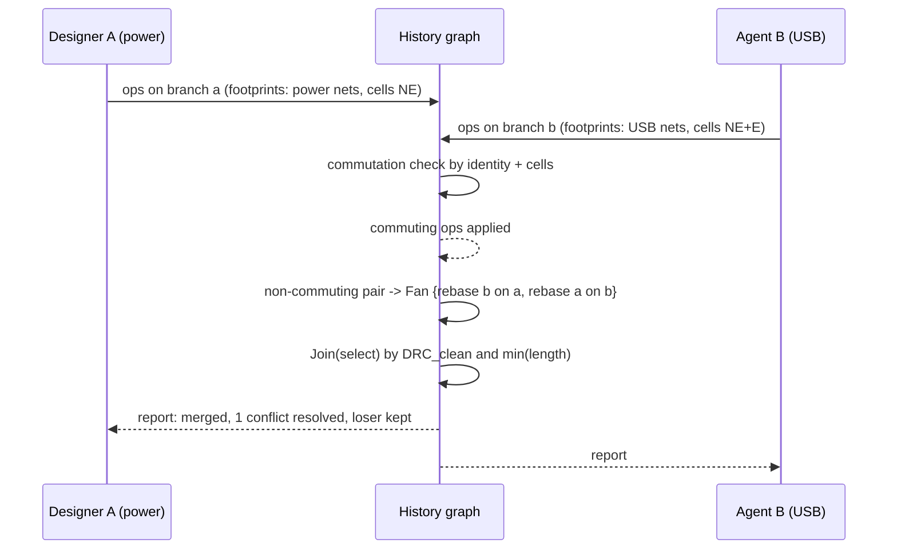
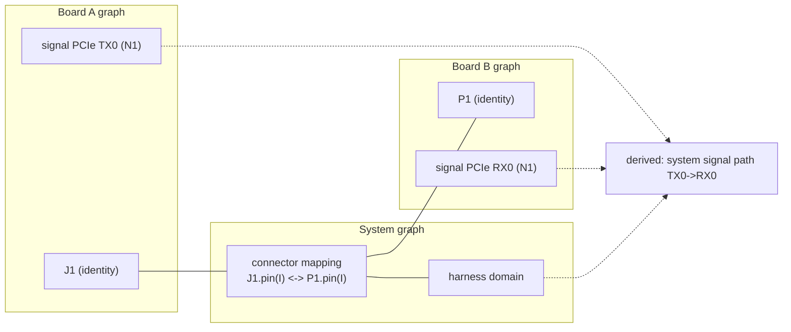
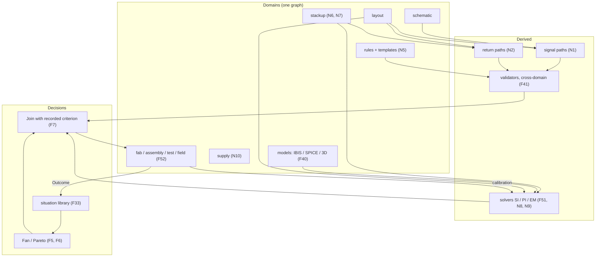
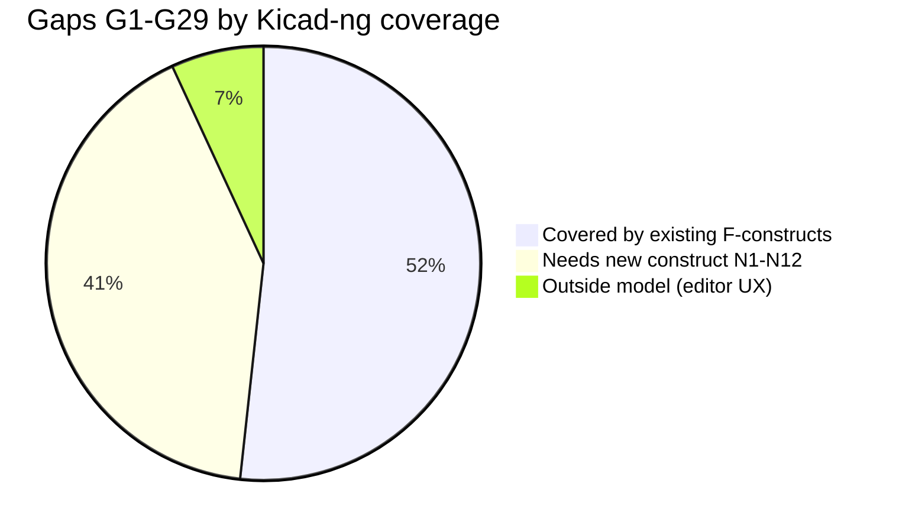

# Kicad-ng: From Hobby to Professional High-Speed EDA — Gap Roadmap

Draft v0.1, 2026-10-12. Companion to `design/history-graph-model.md` (v0.9).

Purpose: list what KiCad lacks on the way from a hobbyist tool to a professional
high-speed / multilayer EDA suite (Allegro, Xpedition, Altium), ordered in waves
from small to global, and map every gap onto the Kicad-ng graph model: which
existing constructs (F1–F55) cover it, and which **new constructs** (N1–N12) and
scenarios (C33–C44) it requires.

---

## 0. Baseline: KiCad 10 (March 2026)

Gaps are measured against KiCad 10.0.x, not older versions. Already present:

| Area | KiCad 10 status |
|---|---|
| Length/delay tuning | Time-domain tuning, Tuning Profiles per layer, router aligned with DRC |
| Impedance | Entered per layer in tuning profiles; integrated field solver announced as future work |
| Rules | Custom rule language + new graphical rule editor; DRC fix suggestions |
| Vias | Blind/buried/micro, padstacks (v9), backdrill and post-machining (counterbore/countersink), IPC-4761 via protection |
| Reuse | Schematic + PCB design blocks, board layout libraries, multichannel (v9) |
| Variants | Design variants (v10) |
| Pin swap | Pin/gate swap (v10) |
| Output | Gerber X2, IPC-2581 (v8), ODB++ (v9), jobsets (v9) |
| Import | Altium, Allegro, PADS, gEDA/Lepton, EasyEDA, others |
| Simulation | ngspice (circuit level), no channel/SI/PI solvers |
| API | IPC API (protobuf) since v9 |

So the remaining gap is not about missing buttons. It is in three layers:
**constraint control**, **analysis**, and **process**.

---

## 1. Wave 1 — Router and rule details

Daily friction on 8–16 layer boards.

| # | Gap | Professional reference | Kicad-ng coverage | New construct |
|---|---|---|---|---|
| G1 | Pin-to-pin delay through series parts (R, AC caps), fly-by branches with per-branch targets | Altium xSignals, Allegro pin-pair | F11 derive, F12 layout.by_identity, F19 profiles | **N1** `derive.signal_path` |
| G2 | In-pair phase matching along the path (compensation near the mismatch), uncoupled-length limit, dynamic skew | Allegro dynamic phase, Xpedition | F19 (metric/constraint of HS profile), F11 validator | — |
| G3 | Return-path checks: split crossing, reference change without return via, trace near plane edge | HyperLynx DRC, Allegro SRC | F19 (reference-layer continuity is in HS identity, §8.5) | **N2** `derive.return_path` |
| G4 | Bus routing: N traces at once, group glossing/hugging | Altium multi-route, Allegro bundles | F5 fan, F18 homotopy | **N3** `canon.bundle` |
| G5 | Automatic BGA fanout (dog-bone, via-in-pad, escape by layer) | Allegro/Xpedition fanout | F5, F32 situation_key, F33 library | — |
| G6 | Via fences, shielding, stitching as rule-driven objects | Altium via shielding, Xpedition | F11 | **N4** `derive.materialized_geometry` |
| G7 | Query-based mass selection and edit | Altium Query, Allegro find | editor level | — (outside model) |
| G8 | HDI rules: stacked/staggered microvia, any-layer, aspect ratio per span, legal layer pairs | Allegro, Xpedition HDI | rules domain (§8.2), F21 fab_grid | — |

### N1 — Signal path as derived

A "signal" is not a net: it is the electrical path from driver pin to receiver
pins through passive series elements. In Kicad-ng this is derived from schematic
(identity of parts + their role) and layout (routes), never stored.

Rules then target `signal_path`, not nets: a matched group of DQ signals is a
constraint over derived delays. Changing R1 to 0R in a variant (F14) invalidates
only the derived path.

### N2 — Return path as derived

Reference planes per segment are derived from stackup + zone fills. Violations
are a validator, and the "reference layer sequence" enters L2 identity for the
high-speed profile, so `Join` with a human criterion goes `stale` when the
return path changes, not when coordinates change.

### N3 — Bundle homotopy

A bus routed together has a **joint** homotopy class: the ordered bundle passes
the same obstacle cuts. Canonizing the bundle (one signature + order) instead of
N independent ones collapses the fan for bus routers and makes "bus intent"
inferable for hand-routed buses (F22).

### N4 — Materialized derived geometry

Fences, teardrops, stitching arrays are functions of (route, rule). Storing them
as state creates churn in history and false conflicts. Model: they are derived,
materialized for output and DRC, cached by input hash (like zone fills, §4).
User override turns a specific instance into an X-op on state.

---

## 2. Wave 2 — Constraint manager and stackup physics

Semi-professional level.

| # | Gap | Professional reference | Kicad-ng coverage | New construct |
|---|---|---|---|---|
| G9 | Tabular constraint manager: interface → group → class → net → pair; target / actual / margin live, cross-probing | Allegro CM, Xpedition CES, Altium xSignals | rules domain effective table (§8.2), F11 derive (actual), F19 profiles | — (view over existing) |
| G10 | Constraints captured at schematic stage and carried to layout | Xpedition CES | rules is a separate domain referencing identities (F1, F12) | — |
| G11 | Interface templates: DDR4/5, LPDDR, PCIe Gen3–5, USB3, MIPI, 10G+ | Allegro/Xpedition kits, vendor design guides | F19, F33 library | **N5** `rules.interface_templates` |
| G12 | Material library: Dk/Df vs frequency, glass weave, resin content, copper roughness (Huray), etch factor; fab-supplied stackups | Polar Si9000, Allegro, Xpedition | F40 domains.models, F42 external evidence | **N6** `domains.stackup` |
| G13 | 2D field solver bound to stackup, impedance and delay derived, not entered | Polar, Allegro, HyperLynx | F51 derive.solvers | — |
| G14 | Rigid-flex: per-region stackups, bend areas, flex rules | Allegro, Altium, Xpedition | F4 spatial footprint | **N7** `stackup.regional` |

### Constraint hierarchy

The constraint manager UI is a **projection** of the rules-domain effective
table joined with derived actuals. It needs no new construct; it needs the
effective table to be first-class (which §8.2 already requires for canonization).

### N5 — Interface templates

A template is a versioned package: profile assignments + rule rows + group
topology + recommended situation keys. Applying it is an op in `rules`;
upgrading the template version (DDR4 → DDR5, or vendor errata) is a rules change
that triggers ordinary re-decision (§3.4). Templates are publishable to the
situation library (F33) together with outcomes.

### N6 — Stackup as its own domain

Today stackup sits implicitly in `rules`. Separating it:

- identity: layer order, materials (by library identity), thicknesses on fab grid,
  copper weight, roughness model
- constraints: fab capability (from fab profile, external evidence F42)
- derived: per-layer impedance and delay tables via solver (F51)

Fab-supplied stackups arrive as X-ops with evidence; the difference between
"designed" and "as-built" stackup (lab TDR measurement) is an `Outcome`.

### N7 — Regional stackups

Stackup becomes a function of region: `stackup(cell)`. Spatial footprints (F4)
already partition the board; a rigid-flex board is a board whose cells map to
different stackup identities. Validators and solvers read the stackup of the
cells a route passes through.

---

## 3. Wave 3 — Analysis: SI / PI / EMI

The real boundary with professional suites.

| # | Gap | Professional reference | Kicad-ng coverage | New construct |
|---|---|---|---|---|
| G15 | Pre-layout what-if: topology from transmission lines + IBIS, termination sweeps before routing | HyperLynx LineSim, Allegro SigXplorer | F5/F6 Pareto fan over topologies, F16 policy | — |
| G16 | Post-layout channel extraction (SPICE / S-parameters), eye, crosstalk, IBIS-AMI, COM / masks | HyperLynx, Sigrity, Altium SI | F51; F30 reverse derive (currently RF only) | **N8** generalize F30 → `derive.reverse` for HS profiles |
| G17 | PI: DC IR drop, AC PDN impedance with decap models, plane resonance | PowerDC, PDN Analyzer, HyperLynx PI | F51, F5 (decap placement fan) | — |
| G18 | Rule-based EMI/SI DRC across the whole board | HyperLynx DRC | F11 validators; F50 proxy.trust calibrates them | — |
| G19 | Full-wave 3D EM on demand for critical regions (BGA breakout, connector, via transition) | HFSS, Clarity, openEMS | F51 with budget | **N9** `canon.spatial_merkle` |
| G20 | Thermal (board + components) | Celsius, FloTHERM | F51, F40 (thermal models) | — |

### Analysis flow in the model

### N8 — Reverse derivation for high-speed

§8.6 introduced layout → electrical model for RF. The same edge is needed for
any HS net whose profile includes a channel model: the electrical semantic unit
is the channel, and layout participates in it. Generalization: the profile
declares whether the reverse edge exists; plain nets never have it.

### N9 — Spatial Merkle

Expensive solvers are only affordable if memoized by the hash of their **local**
inputs. Per-domain Merkle (§1.1) is keyed by identity; a 3D EM solve of a via
transition depends on a spatial neighborhood. Add a second Merkle index keyed by
quadtree cell (§6, open question 2) over L1 geometry + stackup; solver inputs are
the hash of a cell set. An edit far away does not invalidate the solve.

---

## 4. Wave 4 — Process and enterprise

| # | Gap | Professional reference | Kicad-ng coverage | New construct |
|---|---|---|---|---|
| G21 | Library lifecycle: states, AML/AVL, where-used, review, revisions | Altium 365, Xpedition DxDatabook, Allegro CIS | F40, F41, where-used = reverse traversal over F11/F13 | — |
| G22 | Supply chain: availability, EOL, alternates, cost | Altium 365 / Octopart, SiliconExpert | F42 external evidence | **N10** `domains.supply` |
| G23 | Team design: concurrent editing of one board, partitioning, merge | Allegro Symphony, Xpedition Team Design | F1, F3, F4, F10 merge.as_fan | — |
| G24 | ECO flow, release management, frozen revisions, change reports | all vendors | F15 asof, F16 linearize, F8 human_saw, F39 gates | — |
| G25 | Multi-board / system design: connectivity through connectors, harness | Altium multi-board, Xpedition system | — | **N11** `system.multiboard` |
| G26 | ECAD-MCAD incremental exchange (IDX) | all vendors | mechanical domain (F40); history is already an op journal | — |
| G27 | Fab/assembly drawings with live stackup and drill tables; DFM; ICT / flying-probe coverage | Altium Draftsman, Valor, Allegro | F11 (drawings are derived), F55 dfx_costed, F54 test.voi | — |
| G28 | Scale: 20k+ parts, 30+ layers with interactive DRC and fills | Allegro, Xpedition | F25 store, F11 lazy derive, N9 | — |
| G29 | LTS releases, tool qualification for regulated industries | Cadence/Siemens with certification kits | F24 exact-or-report, canon versioning (§8.4), F39 | **N12** `qualify.replay` |

### Team design as merge-as-fan

Professional suites lock regions. Kicad-ng merges by commutation and turns
conflicts into fans (§3.3); partitioning becomes an optional policy, not a
requirement.

### N10 — Supply domain

Parts carry supply facts (lifecycle, lead time, price, alternates) that change
without any design op. They arrive as X-ops with evidence from distributors.
Derived: BOM risk, cost. A part going EOL invalidates `Join` criteria that read
BOM risk; a forced substitution is an ordinary schematic op whose cross-domain
validators (F41: symbol ↔ footprint ↔ 3D ↔ SPICE) run automatically.

### N11 — Multi-board

Each board is its own graph. A system graph references boards by state hash and
holds **connector mappings**: identity of connector pin on board A ↔ identity on
board B, plus cable/harness domain. Cross-board signal paths (N1) span the
mapping. A pin swap on one board invalidates derived system connectivity, and
the mismatch shows like any other validator failure.

### N12 — Qualification by replay

Tool qualification asks: is output reproducible and are changes traceable?
Kicad-ng answers structurally: any released state can be re-derived from the op
journal (D-ops replayed, X-ops by result) and compared byte-for-byte on outputs
(Gerber, IPC-2581). `qualify.replay` is a validator in the certifiable process
profile; failure is exact-or-report (F24).

---

## 5. Wave 5 — Global: unified model, closed loop

What neither KiCad nor the incumbents have, and where the Kicad-ng model aims.

Key claims:

1. **"Control everything" = profile + derived, not a bigger DRC.** A DDR net's
   identity includes topology and reference sequence; an RF net's includes
   geometry on fab grid. Incumbents spread this across constraint manager,
   SI package and DFM package with file round-trips between them.
2. **Solvers in the loop, calibrated by outcomes.** The incumbent failure mode
   (simulation clean, board fails) is the false lock on proxies (§12.5); the
   outer loop (F49) addresses it directly.
3. **No "Update PCB", no "export to SI tool", no "import from SI tool".**
   Every such step is a derived edge.

---

## 6. Summary: coverage

| Status | Gaps |
|---|---|
| Covered by existing constructs | G2, G5, G8, G9, G10, G13, G15, G17, G18, G20, G21, G23, G24, G26, G27 |
| Needs new construct | G1 (N1), G3 (N2), G4 (N3), G6 (N4), G11 (N5), G12 (N6), G14 (N7), G16 (N8), G19 (N9), G22 (N10), G25 (N11), G29 (N12) |
| Editor-level, outside model | G7; G28 partially (rendering/UX) |

## 7. Superset additions

| # | Construct | Flag | Section | Scenario |
|---|---|---|---|---|
| N1 | Signal path through series parts as derived | `derive.signal_path` | §1 | C33 |
| N2 | Return path / reference planes as derived, in HS identity | `derive.return_path` | §1 | C34 |
| N3 | Joint homotopy for bundles | `canon.bundle` | §1 | C35 |
| N4 | Rule-generated geometry as materialized derived | `derive.materialized_geometry` | §1 | C36 |
| N5 | Versioned interface templates | `rules.interface_templates` | §2 | C37 |
| N6 | Stackup domain with frequency-dependent materials | `domains.stackup` | §2 | C38 |
| N7 | Region-dependent stackup | `stackup.regional` | §2 | C39 |
| N8 | Reverse derivation layout → electrical for HS profiles | `derive.reverse` (generalizes F30) | §3 | C40 |
| N9 | Spatial Merkle index for local solver memo | `canon.spatial_merkle` | §3 | C41 |
| N10 | Supply domain | `domains.supply` | §4 | C42 |
| N11 | Multi-board system graph | `system.multiboard` | §4 | C43 |
| N12 | Qualification by replay | `qualify.replay` | §4 | C44 |

## 8. Scenario additions

| # | Scenario | Board | Event |
|---|---|---|---|
| C33 | DDR4 fly-by with series terminations | DDR | R value changed in variant; only affected signal paths re-derived, group skew re-checked |
| C34 | Plane split moves under DQ routes | DDR | Return-path validator fires; human Join goes stale on reference sequence, not on coordinates |
| C35 | 16-bit bus routed as bundle vs individually | DDR | Fan size and convergence compared with N3 on/off |
| C36 | Track moved next to via fence | RF + plain | Fence regenerated as derived; no history churn; no false merge conflict |
| C37 | Interface template upgrade | DDR | Template v1 → v2 (vendor errata); re-decision report |
| C38 | Material swap (FR-4 → low-loss) | HS | Impedance/delay tables re-derived; tuning targets in time domain still met or reported |
| C39 | Rigid-flex | mixed | Route crossing region boundary validated against both stackups |
| C40 | PCIe Gen5 channel | HS | Post-layout extraction; COM computed; Join by margin |
| C41 | Local EM memo | HS | Edit in another quadrant; 3D EM result for BGA breakout reused (hit rate measured) |
| C42 | Part goes EOL | any | Supply X-op; BOM risk derived; substitution validated cross-domain |
| C43 | Two boards via connector | system | Pin swap on board A; system signal path mismatch reported |
| C44 | Release replay | any | Released state re-derived from journal; outputs byte-identical or diff reported |

## 9. Implications for Kicad-ng scope

- Waves 1–2 and part of 4 will be closed by KiCad itself; Kicad-ng should reuse
  KiCad editors and formats there, not compete.
- Wave 3 will not land in KiCad core soon: it is solver products. Kicad-ng's
  derived layer (F11, F51, N8, N9) is the integration surface for external
  solvers (openEMS, ngspice, commercial via adapters).
- Wave 5 cannot be built inside KiCad's architecture (file-pair model, imperative
  update). It is the Kicad-ng core.
- Highest-leverage new constructs for high-speed multilayer work, in order:
  **N6** (stackup domain) → **N1** (signal path) → **N2** (return path) →
  **N9** (spatial Merkle, makes solvers affordable) → **N8** (reverse derive).
